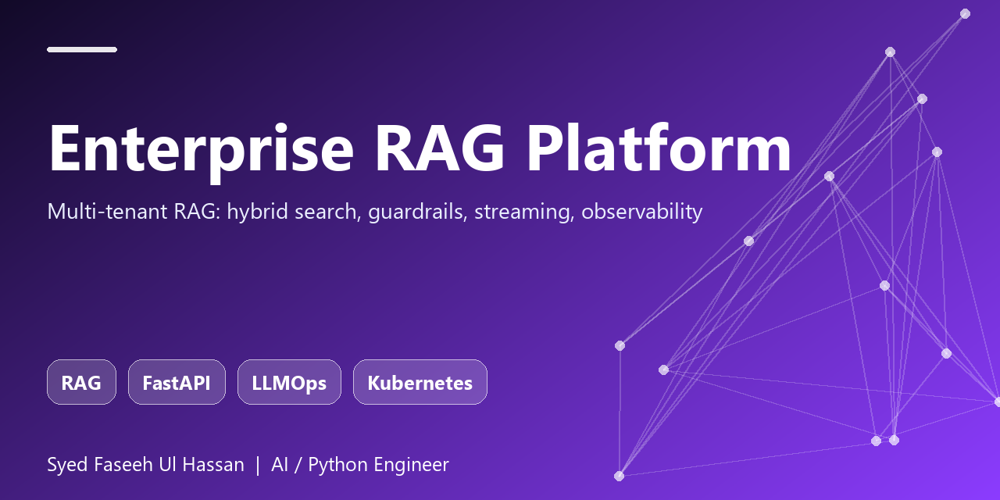

<p align="center"></p>

# Enterprise RAG Platform

A multi-tenant retrieval-augmented generation service built the way it would be run in production: structure-aware
ingestion, hybrid search, prompt-injection and PII guardrails, streaming answers with validated citations,
per-tenant isolation, Prometheus metrics, Docker/Kubernetes deployment and a CI regression gate for answer quality.

  

## What it does
| Area | Implementation |
|---|---|
| Ingestion | Markdown / HTML / PDF / text parsers, heading-path-aware chunking with token budget + overlap, idempotent re-ingest by content hash |
| Retrieval | SQLite FTS5 BM25 + dense vectors, Reciprocal Rank Fusion, pluggable cross-encoder reranker, MMR diversification |
| Generation | Anthropic Messages API, any OpenAI-compatible server (OpenAI, vLLM, Ollama), offline extractive fallback; SSE streaming |
| Safety | Indirect prompt-injection screening, refusal when context does not support the question, citation validation, PII redaction |
| Multi-tenancy | Tenant id on every row/query, hashed API keys, admin-provisioned tenants, per-key rate limiting |
| Ops | `/healthz`, Prometheus `/metrics`, JSON request logs with request ids, non-root Docker image, K8s manifests |
| Quality | 14 tests incl. tenant isolation and injection cases, plus an eval gate (recall, grounding, refusal) that runs in CI |

## Run it
```bash
pip install -e ".[dev]"
RAG_ADMIN_KEY=change-me uvicorn ragplatform.api.app:create_app --factory --port 8000
```
```bash
# 1. create a tenant (returns that tenant's API key once)
curl -X POST localhost:8000/v1/admin/tenants -H "Authorization: Bearer change-me" \
  -H "Content-Type: application/json" -d '{"tenant_id":"acme","name":"Acme"}'

# 2. ingest a document
curl -X POST localhost:8000/v1/documents -H "Authorization: Bearer $KEY" \
  -H "Content-Type: application/json" -d '{"name":"handbook.md","content":"# Leave\nStaff get 25 days of annual leave."}'

# 3. ask (add /stream for server-sent events)
curl -X POST localhost:8000/v1/query -H "Authorization: Bearer $KEY" \
  -H "Content-Type: application/json" -d '{"question":"How many days of annual leave?"}'
```
Use a real model: `RAG_LLM_PROVIDER=anthropic RAG_LLM_API_KEY=... RAG_LLM_MODEL=claude-sonnet-5-5`.
Or `docker compose up` (API + Prometheus).

## Quality gate
```bash
pytest -q && python evals/run_eval.py
```
The eval ingests a fixture corpus and fails the build if recall@k, grounded-answer rate or correct-refusal rate drops below threshold.

## Docs
- [Architecture, decisions, scaling path and known limitations](docs/architecture.md)
- Kubernetes: [`deploy/k8s/deployment.yaml`](deploy/k8s/deployment.yaml)

## Author
**Syed Faseeh Ul Hassan** - Python / AI engineer, MSc AI & Big Data - Cambridge, UK.
[syedfaseeh.com](https://syedfaseeh.com) - [LinkedIn](https://www.linkedin.com/in/syed-faseeh-ul-hassan-809595103/)
