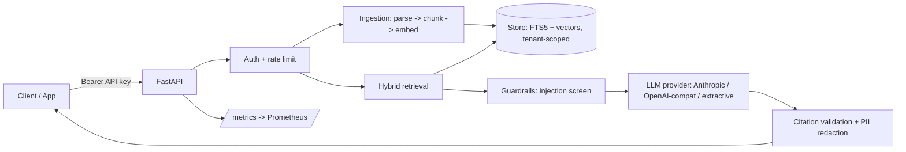

# Architecture

## Request path (query)
1. **Auth**: API key is hashed (SHA-256) and resolved to a tenant. A sliding-window limiter protects each key.
2. **Retrieve**: BM25 (SQLite FTS5, porter stemming) and dense cosine search each return 25 candidates, fused with
   Reciprocal Rank Fusion (k=60), optionally cross-encoder reranked, then diversified with MMR (lambda 0.7).
3. **Support check**: if too few of the question's content words appear in any passage, the service refuses
   instead of letting the model guess (`no_support` flag).
4. **Guardrails**: instruction-like lines inside retrieved documents are removed before prompting (indirect prompt
   injection); the system prompt marks context as untrusted data.
5. **Generate**: provider-agnostic `LLM` interface, with SSE streaming.
6. **Validate**: citations must refer to real passages; PII (emails, Luhn-valid cards, phone numbers) is redacted from output.

## Design decisions
| Decision | Why | Trade-off |
|---|---|---|
| Tenant id on every table and every query | Isolation by construction; tested explicitly (cross-tenant read, delete) | Schema-level only; add Postgres RLS for defence in depth |
| SQLite FTS5 + brute-force cosine | Zero-infra, deterministic, fast to test | O(n) dense scan; fine to ~100k chunks per tenant |
| Idempotent re-ingest by content hash | Safe retries, cheap re-syncs; changed docs replace atomically | Hash is over chunk hashes, so parser changes re-index |
| Refuse when unsupported | Wrong answers cost more than "I don't know" | Slightly more refusals on vague questions |
| Eval gate in CI | Retrieval quality regressions fail the build | Golden set must be maintained |

## Scaling path
- Swap `Store` for Postgres + `pgvector` (HNSW) + `tsvector`; keep the `add_document / search_bm25 / search_dense` seam.
- Move rate limiting to Redis; run N API replicas; push ingestion to a queue (SQS/Celery) with a worker.
- Replace `HashEmbedder` with `HTTPEmbedder` (OpenAI-compatible, TEI or Ollama) and add a cross-encoder `Reranker`.
- Export traces with OpenTelemetry; the request-id middleware already propagates `x-request-id`.

## Known limitations (honest list)
- The offline `HashEmbedder` is lexical, so synonym-heavy questions need a real embedding model.
- In-process rate limiting is per replica.
- The extractive answerer is for demos/tests; production should use a real LLM provider.
